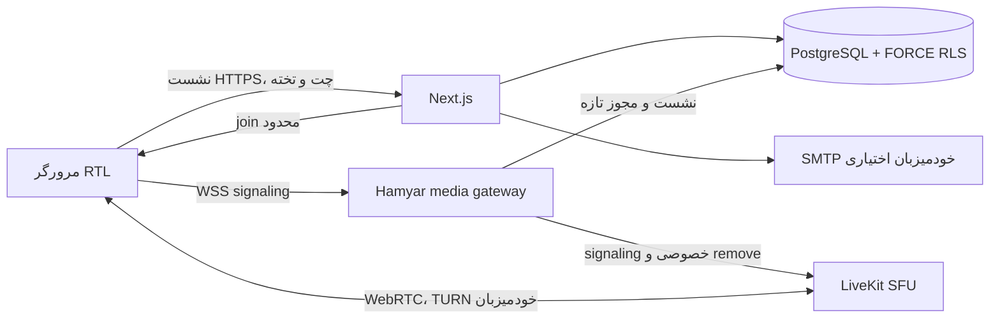

# معماری همیار

همیار یک modular monolith برای وب/منطق کسب‌وکار و سرویس مستقل SFU/TURN و signaling gateway برای رسانه دارد. تصمیم‌های جاری در ADRهای 0003، 0007 و [0008](adr/0008-persisted-classroom-and-owned-media.md) هستند. [راهنمای سورس](CODE_GUIDE.fa.md) مسیر هر بخش و جریان درخواست را توضیح می‌دهد.

## فناوری و دلیل

| لایه            | انتخاب                                       | وضعیت/دلیل                                                |
| --------------- | -------------------------------------------- | --------------------------------------------------------- |
| وب/API          | Next.js App Router، React، TypeScript strict | یک codebase، SSR مجاز و SDK تنبل اتاق                     |
| رابط            | CSS tokens، Vazirmatn محلی و Lucide          | RTL، دو تم، بدون CDN ضروری                                |
| داده            | PostgreSQL، SQL migrations و Drizzle هویت    | persistence، transaction، composite FK و FORCE RLS        |
| حساب            | Better Auth + دامنهٔ سازمان اختصاصی          | رمز/نشست واقعی؛ MFA حساب معمولی با ADR 0007 حذف شده       |
| رسانه           | LiveKit متن‌باز، WebRTC، TURN                | خودمیزبان؛ Cloud اجباری نیست                              |
| کنترل signaling | Node، ws، PG و SDK سرور                      | بررسی نشست و ACL اتصال/reconnect و لغو اتصال برقرار       |
| همکاری          | API + snapshot محدود PostgreSQL              | چت/تختهٔ واقعی روی ورسل و Linux بدون سرویس realtime خارجی |
| ایمیل           | SMTP TLS یا adapter اختیاری Resend           | فرستندهٔ خودمیزبان؛ بدون فرستنده recovery غیرفعال         |
| ضبط هدف         | Egress + worker + storage خصوصی              | هنوز پیاده نشده؛ مستقل از وب                              |
| صف/HA آینده     | Redis/worker در صورت نیاز عملی               | پیش‌نیاز runtime تک‌گرهٔ جاری نیست                        |

## مرز اعتماد و داده

`tenancy` org را از نشست معتبر و role را از membership فعال می‌گیرد. هر query/mutation دامنه در transaction با context موقت اجرا می‌شود. نقش runtime غیرمالک، بدون superuser/bypass و با ۱۳ جدول FORCE RLS است. SQL migrations مرجع constraints/RLS هستند؛ Drizzle schema فعلی adapter هویت و مدل اولیهٔ سازمان/اتاق را پوشش می‌دهد. برای مدل‌های جدید collaboration از SQL scoped service استفاده می‌شود؛ drizzle push روی تولید مسیر migration نیست.

`rooms/policy` تصمیم خالص مجوز را می‌گیرد؛ `classroom` lifecycle، تخته، چت، حضور، لینک و کنترل را در همان مرز اجرا می‌کند. `support` ticket/reply و `organization-settings` برند خود سازمان را ذخیره می‌کنند. `operations` فقط مشخصات عمومی محدود یا mode اپراتور را می‌خواند. UI هیچ اتصال DB و هیچ کلید امضایی ندارد.

## چرخهٔ همکاری

snapshot شامل ۸۰ پیام آخر، حداکثر ۲۰۰ خط تخته و حداکثر ۲۰۰ عضو فهرست اتاق است. polling هر ۸ ثانیه و heartbeat هر ۲۴ ثانیه است؛ tab پنهان polling ندارد. چت clientId dedup دارد، عملیات تخته row lock و revision؛ author فقط سمت سرور اضافه می‌شود. presence به معنی حضور وب است و گزارش قطعی دریافت رسانه نیست. latency قلم زنده و CRDT هنوز هدف مرحلهٔ بعدند.

دعوت اتاق capability است و با دعوت ایمیلی مالکیت حساب تفاوت دارد. پذیرش با hash context محدود قبل از تعیین org انجام می‌شود، سپس org از خود رکورد معتبر گرفته می‌شود. لینک حق مدیریتی نمی‌سازد؛ ban، تعلیق، expiry و سقف استفاده بررسی می‌شوند.

## مجوز و کیفیت رسانه

join فقط با نشست/عضویت/اتاق تازه و توکن حداکثر ۵ دقیقه است؛ برای grant کوتاه‌تر TTL نیز کوتاه‌تر می‌شود. roomAdmin، data publish و تغییر metadata در مرورگر فعال نیستند. gateway raw JWT واقعی را با وضعیت تازهٔ DB مقایسه می‌کند. اتصال قدیمی که publication بیش از مجوز جاری دارد حذف می‌شود. گسترش مجوز اتصال read-only خودکار نیست؛ join تازه لازم است. بررسی دوره‌ای پنج‌ثانیه‌ای و حذف SFU به سلامت DB و API خصوصی وابسته‌اند؛ TTL به‌تنهایی revocation رسانه نیست.

SDK adaptiveStream، dynacast، simulcast، VP8 و پیش‌فرض 720p/24fps دارد؛ آن‌ها تضمین کار با هر پهنای باند نیستند. اجازهٔ دستگاه/صفحه فقط در gesture است. reconnect کوتاه توسط SDK؛ پس از شکست نهایی دکمهٔ اتصال fresh token می‌خواهد. خروج، لغو و نتیجهٔ دیرهنگام اتصال trackها را آزاد می‌کنند. بزرگ‌نمایی رسانه با dialog کیبوردپذیر است.

## دو پروفایل از یک release

normal برای تست ورسل یا سرور عادی است؛ domestic به allowlist سرویس‌های داخلی متکی است. این انتخاب runtime است، نه fork محصول و نه انتقال خودکار داده. همهٔ assetهای ضروری محلی‌اند؛ سرویس Cloud رسانه یا realtime اجباری نیست. در ورسل فقط وب/API اجرا می‌شود و DB آزمایش فعلی Neon است. برای رسانهٔ عمومی SFU/TURN/gateway عمومی معتبر لازم است. [SELF_HOSTING](SELF_HOSTING.md) نصب، مرز کلیدها، image آفلاین و تمرین قطعی را توضیح می‌دهد.

## اهداف قابل اندازه‌گیری

هدف اولیه: p95 درخواست کنترل زیر 300ms، ورود رسانه زیر 5s با دستگاه آماده، بازیابی قطع کوتاه زیر 10s. این‌ها benchmark یا SLA انجام‌شده نیستند. سناریوی هدف شروع ۳۰ دانش‌آموز و یک مدرس است؛ ظرفیت واقعی به ناشر/subscriber، bitrate، TURN، CPU، خروجی و ضبط وابسته است. آمار نامشخص به صورت نامشخص نمایش داده می‌شود. ضبط، چندمنطقه و HA بدون آزمون عملی آماده اعلام نمی‌شوند.
