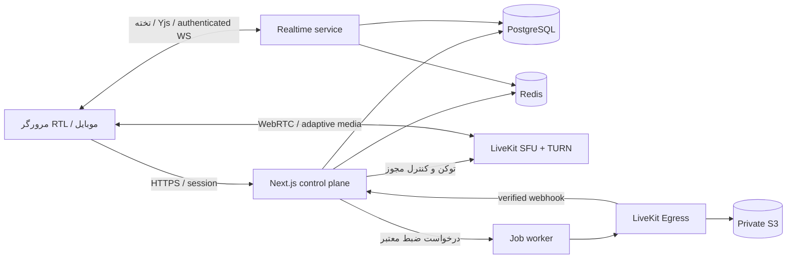

# معماری همیار

تصمیم اولیه: یک modular monolith برای منطق کسب‌وکار، با سرویس‌های رسانه و همگام‌سازی مستقل. پیچیدگی عملیاتی باید متناسب با استفادهٔ واقعی رشد کند.

## انتخاب فناوری

| لایه       | انتخاب                                       | دلیل و وضعیت                                                          |
| ---------- | -------------------------------------------- | --------------------------------------------------------------------- |
| برنامه     | Next.js App Router، React، TypeScript strict | نصب‌شده؛ پنل و API در یک codebase، بارگذاری تدریجی اتاق               |
| طراحی      | CSS tokens، Lucide، Vazirmatn محلی           | نصب‌شده؛ RTL و دو تم، بدون وابستگی به CDN فونت                        |
| رسانه      | LiveKit، WebRTC، SFU                         | SDK نصب‌شده؛ server قابل میزبانی شخصی با Redis و TURN                 |
| داده       | PostgreSQL + Drizzle                         | PostgreSQL در compose توسعه تعریف شده؛ ORM و مدل نهایی در فاز داده    |
| احراز هویت | Better Auth + سازمان + MFA                   | انتخاب معماری، هنوز نصب یا متصل نیست؛ نقش‌های آموزشی در دامنهٔ خودمان |
| موقت/صف    | Redis + BullMQ                               | Redis در compose تعریف شده؛ صف پس از اولین worker                     |
| تخته       | SVG UI اولیه؛ Yjs + WebSocket provider       | تختهٔ فعلی محلی است؛ Yjs، persistence و ACL در فاز همگام‌سازی         |
| ضبط        | LiveKit Egress + worker + S3 سازگار          | انتخاب معماری؛ Egress و storage هنوز راه‌اندازی نشده‌اند              |
| پایش       | OpenTelemetry، Prometheus و گزارش خطا        | برنامهٔ فاز production؛ بدون جمع‌آوری محتوای خصوصی                    |

NestJS می‌تواند هنگام جداسازی control API اضافه شود؛ در شروع نگهداری دو backend برای یک تیم کوچک فایدهٔ اثبات‌شده ندارد. Kubernetes و چند منطقه پس از اندازه‌گیری ظرفیت، هزینه و نیاز دسترس‌پذیری.

## مرز ماژول‌ها

`identity` نشست و MFA؛ `tenancy` سازمان و membership؛ `education` کلاس و enrollment؛ `rooms` برنامه و نشست و مجوز؛ `chat` تاریخچه و moderation؛ `whiteboard` سند مشترک؛ `recordings` lifecycle و retention؛ `audit` رویدادهای حساس؛ `branding` تنظیمات ظاهری. هر ماژول repository خودش را دارد؛ UI مستقیم به پایگاه داده دست نمی‌زند.

کد فعلی `src/modules/rooms` سیاست دسترسی خالص و grants رسانه را پیاده می‌کند. `src/modules/media` تنظیمات SDK و یک adapter صدور توکن سمت سرور دارد؛ endpoint عمومی صدور توکن تا پیاده‌سازی نشست و repository وجود ندارد.

## مدل دادهٔ هدف

`User` سراسری؛ `Organization(kind: school|company|personal)`؛ `Membership(userId, organizationId, role, status)`؛ `AcademicYear`، `Class`، `Subject`، `Enrollment`، `TeachingAssignment`؛ `Room`، `Session`، `RoomAssignment`، `MediaPermission`، `AttendanceInterval`، `Message`، `BoardDocument`، `Recording` و `AuditEvent`.

تمام موجودیت‌های سازمانی دارای organizationId هستند. foreign keyهای مرکب `(organization_id, id)`، uniqueهای scoped، index روی `(organization_id, session_id, created_at)`، و repositoryهای tenant-scoped لازم‌اند. PostgreSQL RLS با نقش غیرمالک و FORCE RLS پس از طراحی کامل نشست افزوده می‌شود؛ هیچ ادعای RLS پیاده‌شده در این نسخه نداریم. اتصال pool باید tenant context را در transaction تنظیم و پاک کند.

## کیفیت و شبکه

`adaptiveStream` رزولوشن دریافت را متناسب با tile قابل مشاهده انتخاب می‌کند؛ `dynacast` لایه‌های بی‌مصرف ارسال را متوقف می‌کند؛ simulcast چند سطح ارائه می‌دهد. این‌ها جایگزین محدودیت پهنای باند یا تنظیم bitrate نیستند. دوربین پیش‌فرض 720p/24fps، مدرس در اولویت، اشتراک صفحه با نرخ متناسب با محتوا و گزینهٔ فقط صدا. UI اتاق و SDK فقط در مسیر اتاق دانلود می‌شوند.

SDK اتصال مجدد رسانه را مدیریت می‌کند؛ وضعیت reconnecting نمایش داده شود. اگر اتصال نهایی شکست خورد، درخواست توکن جدید از نشست معتبر و retry با backoff/jitter محدود انجام شود. دسترسی و ban هنگام reconnect دوباره بررسی شود. چت persisted با شناسهٔ idempotency، تخته با resync snapshot؛ از ارسال مجدد کورکورانهٔ عملیات جلوگیری شود. تغییر نقش با UpdateParticipant، نه انتظار برای انقضای JWT. ban شامل حذف participant، لغو join و بررسی مسیر reconnect خودمیزبان است.

## اهداف قابل اندازه‌گیری

هدف شروع: p95 درخواست کنترل کمتر از 300ms در محیط تست مشخص؛ p95 ورود کمتر از 5s با دستگاه ازپیش‌اجازه‌داده؛ بازیابی قطع کوتاه کمتر از 10s؛ صفحه مدیریت بدون SDK رسانه و با حداقل JS. اعداد تضمین یا benchmark انجام‌شده نیستند.

سناریوی ظرفیت اولیه: 30 دانش‌آموز و یک مدرس، دو ناشر دوربین همزمان و 10 اتاق در تست. ظرفیت نهایی تابع تعداد ناشر، subscriber، bitrate، TURN، CPU، ترافیک خروجی و ضبط همزمان است؛ ضبط باید بودجه و ظرفیت مستقل داشته باشد. ایران و مقصد میزبانی باید با تست واقعی ISP سنجیده شوند.

## منابع تصمیم، بررسی‌شده در 2026-10-13

- [Next.js installation](https://nextjs.org/docs/app/getting-started/installation)
- [LiveKit RoomOptions: adaptiveStream/dynacast](https://docs.livekit.io/reference/client-sdk-js/interfaces/RoomOptions.html)
- [LiveKit deployment: TLS, TURN, Redis, network](https://docs.livekit.io/transport/self-hosting/deployment/)
- [LiveKit Egress](https://docs.livekit.io/transport/media/ingress-egress/egress/)
- [Better Auth organization](https://better-auth.com/docs/plugins/organization)

نسخهٔ نصب‌شده و lockfile مرجع API اجرایی‌اند؛ مستندات آنلاین می‌توانند از نسخهٔ SDK جلوتر باشند.
