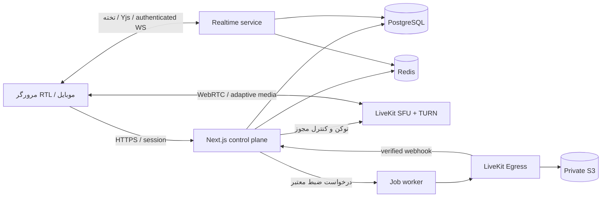

# معماری همیار

تصمیم اولیه: یک modular monolith برای منطق کسب‌وکار، با سرویس‌های رسانه و همگام‌سازی مستقل. پیچیدگی عملیاتی باید متناسب با استفادهٔ واقعی رشد کند.

## انتخاب فناوری

| لایه       | انتخاب                                       | دلیل و وضعیت                                                                      |
| ---------- | -------------------------------------------- | --------------------------------------------------------------------------------- |
| برنامه     | Next.js App Router، React، TypeScript strict | نصب‌شده؛ پنل و API در یک codebase، بارگذاری تدریجی اتاق                           |
| طراحی      | CSS tokens، Lucide، Vazirmatn محلی           | نصب‌شده؛ RTL و دو تم، بدون وابستگی به CDN فونت                                    |
| رسانه      | LiveKit، WebRTC، SFU                         | SDK نصب‌شده؛ server قابل میزبانی شخصی با Redis و TURN                             |
| داده       | PostgreSQL + Drizzle                         | نصب‌شده؛ schema/migration هویت و سازمان و آزمون PG واقعی؛ مدل آموزش در مرحلهٔ بعد |
| احراز هویت | Better Auth + دامنهٔ سازمان + MFA            | نصب‌شده و آزمودهٔ محلی؛ اتصال عمومی نیازمند env و ایمیل معتبر                     |
| موقت/صف    | Redis + BullMQ                               | Redis در compose تعریف شده؛ صف پس از اولین worker                                 |
| تخته       | SVG UI اولیه؛ Yjs + WebSocket provider       | تختهٔ فعلی محلی است؛ Yjs، persistence و ACL در فاز همگام‌سازی                     |
| ضبط        | LiveKit Egress + worker + S3 سازگار          | انتخاب معماری؛ Egress و storage هنوز راه‌اندازی نشده‌اند                          |
| پایش       | OpenTelemetry، Prometheus و گزارش خطا        | برنامهٔ فاز production؛ بدون جمع‌آوری محتوای خصوصی                                |

NestJS می‌تواند هنگام جداسازی control API اضافه شود؛ در شروع نگهداری دو backend برای یک تیم کوچک فایدهٔ اثبات‌شده ندارد. Kubernetes و چند منطقه پس از اندازه‌گیری ظرفیت، هزینه و نیاز دسترس‌پذیری.

## مرز ماژول‌ها

`identity` نشست و MFA؛ `tenancy` سازمان و membership؛ `education` کلاس و enrollment؛ `rooms` برنامه و نشست و مجوز؛ `chat` تاریخچه و moderation؛ `whiteboard` سند مشترک؛ `recordings` lifecycle و retention؛ `audit` رویدادهای حساس؛ `branding` تنظیمات ظاهری. هر ماژول repository خودش را دارد؛ UI مستقیم به پایگاه داده دست نمی‌زند.

کد فعلی `src/modules/rooms` سیاست دسترسی خالص و grants رسانه را پیاده می‌کند. `src/modules/media` تنظیمات SDK و یک adapter صدور توکن سمت سرور دارد؛ endpoint عمومی صدور توکن تا پیاده‌سازی نشست و repository وجود ندارد.

## مدل دادهٔ هدف

`User` سراسری؛ `Organization(kind: school|company|personal)`؛ `Membership(userId, organizationId, role, status)`؛ `AcademicYear`، `Class`، `Subject`، `Enrollment`، `TeachingAssignment`؛ `Room`، `Session`، `RoomAssignment`، `MediaPermission`، `AttendanceInterval`، `Message`، `BoardDocument`، `Recording` و `AuditEvent`.

تمام موجودیت‌های سازمانی دارای organizationId هستند. foreign keyهای مرکب `(organization_id, id)`، uniqueهای scoped، index روی `(organization_id, session_id, created_at)`، و repositoryهای tenant-scoped لازم‌اند. PostgreSQL RLS با نقش غیرمالک و FORCE RLS پس از طراحی کامل نشست افزوده می‌شود؛ هیچ ادعای RLS پیاده‌شده در این نسخه نداریم. اتصال pool باید tenant context را در transaction تنظیم و پاک کند.

## کیفیت و شبکه

`adaptiveStream` رزولوشن دریافت را متناسب با tile قابل مشاهده انتخاب می‌کند؛ `dynacast` لایه‌های بی‌مصرف ارسال را متوقف می‌کند؛ simulcast چند سطح ارائه می‌دهد. این‌ها جایگزین محدودیت پهنای باند یا تنظیم bitrate نیستند. دوربین پیش‌فرض 720p/24fps، مدرس در اولویت، اشتراک صفحه با نرخ متناسب با محتوا و گزینهٔ فقط صدا. UI اتاق و SDK فقط در مسیر اتاق دانلود می‌شوند.

SDK اتصال مجدد رسانه را مدیریت می‌کند؛ وضعیت reconnecting نمایش داده شود. اگر اتصال نهایی شکست خورد، درخواست توکن جدید از نشست معتبر و retry با backoff/jitter محدود انجام شود. دسترسی و ban هنگام reconnect دوباره بررسی شود. چت persisted با شناسهٔ idempotency، تخته با resync snapshot؛ از ارسال مجدد کورکورانهٔ عملیات جلوگیری شود. تغییر نقش با UpdateParticipant، نه انتظار برای انقضای JWT. ban شامل حذف participant، لغو join و بررسی مسیر reconnect خودمیزبان است.

## اهداف قابل اندازه‌گیری

هدف شروع: p95 درخواست کنترل کمتر از 300ms در محیط تست مشخص؛ p95 ورود کمتر از 5s با دستگاه ازپیش‌اجازه‌داده؛ بازیابی قطع کوتاه کمتر از 10s؛ صفحه مدیریت بدون SDK رسانه و با حداقل JS. اعداد تضمین یا benchmark انجام‌شده نیستند.

سناریوی ظرفیت اولیه: 30 دانش‌آموز و یک مدرس، دو ناشر دوربین همزمان و 10 اتاق در تست. ظرفیت نهایی تابع تعداد ناشر، subscriber، bitrate، TURN، CPU، ترافیک خروجی و ضبط همزمان است؛ ضبط باید بودجه و ظرفیت مستقل داشته باشد. ایران و مقصد میزبانی باید با تست واقعی ISP سنجیده شوند.

## میزبانی نسخهٔ نمایشی

به‌روزرسانی ADR 0004: نسخهٔ عمومی دیگر Dashboard یا اتاق نمونه را جای دادهٔ واقعی نمایش نمی‌دهد. هویت به Neon اختصاصی با نقش runtime غیرمالک و اتصال pooled متصل می‌شود. پنل و اتاق‌های نمونه فقط regression محلی با flag توسعه هستند. مدل پایدار meeting_room و room_assignment با composite FK/RLS اضافه شد؛ رسانه هنوز نیازمند سرور LiveKit خودمیزبان و join معتبر است؛ Cloud اختیاری است. شرح اولیهٔ زیر تاریخچهٔ نخستین انتشار است.

برنامهٔ Next.js روی پروژهٔ `hamyar` در Vercel منتشر می‌شود. در حال حاضر دادهٔ نمونه و رابط محلی است و هیچ credential رسانه یا storage لازم ندارد. فایل‌های `.env*`، `.vercel`، artifact و تست از سورس انتشار کنار گذاشته می‌شوند؛ token، secret و تنظیم محلی در Git نگهداری نمی‌شوند. LiveKit SFU، TURN، Egress و فرایند WebSocket تخته باید بعداً روی زیرساخت مناسب و مستقل اجرا شوند؛ Vercel میزبان رابط و API کنترل است، نه media server. پروژه به دلیل خطای دسترسی اتصال GitHub در نخستین link، از CLI منتشر می‌شود؛ اتصال خودکار Git تا تأیید مجوز GitHub ادعا نمی‌شود.

## پیش‌نمایش و جلوهٔ صوتی

`src/modules/media/local-capture.ts` مالک trackهای محلی است و lifecycle آن مستقل از transport است. hooks React صرفاً وضعیت را مشترک می‌کنند؛ دریافت دستگاه فقط در action صریح انجام می‌شود. `useAudioReaction` مصرف‌کنندهٔ یک MediaStream است؛ در آینده می‌تواند به track صوت مدرس از LiveKit متصل شود، اما اکنون فقط میکروفون خود کاربر را تحلیل می‌کند. نمونه‌های float صرفاً در حافظهٔ effect هستند، به سرور یا log نمی‌روند و به speaker وصل نمی‌شوند. analyser و AudioContext هنگام توقف جلوه، خروج یا قطع capture آزاد می‌شوند؛ در tab مخفی پردازش صوتی suspend است.

## نظارت پایه و پشتیبانی

ماژول `operations` فقط projection عمومی و allowlist‌شدهٔ اجرای وب را تولید می‌کند. `/api/status` اطلاعات نشست یا سازمان ندارد، cache نمی‌شود و سلامت رسانه یا ظرفیت را ادعا نمی‌کند. limit/used/remaining تا اتصال دادهٔ واقعی null هستند. API مصرف، مشخصات خصوصی و کنترل اتاق باید در فاز identity/data با نقش معتبر اضافه شوند.

ماژول `support` در این مرحله فقط schema پیش‌نویس نسخه‌دار دارد؛ فرم با اقدام کاربر متن را در مرورگر ذخیره/حذف و دانلود می‌کند. storage یا mutation سروری وجود ندارد. تیکت آینده مدل سازمانی و pipeline ثبت/پاسخ مستقل با audit و idempotency خواهد داشت. [ADR 0002](adr/0002-public-status-and-support-drafts.md) مرز این مرحله را ثبت می‌کند.

## هویت و مرز سازمان

`identity` factory کتابخانه و schema Drizzle دارد؛ runtime در ماژول server-only و با اتصال lazy ساخته می‌شود. `tenancy` سازمان/عضویت/دعوت و audit را در transaction با context RLS اجرا می‌کند. اتصال runtime غیرمالک است و role ناامن فعال نمی‌شود؛ migration اتصال مالک جدا دارد. نشست با DB و بدون cookie cache بررسی می‌شود؛ MFA روی نشست تازه proof دارد، نه فقط روی user. root پس از تنظیم هویت به `/workspace` می‌رود و `/demo` مستقل می‌ماند. [ADR 0003](adr/0003-identity-and-tenant-boundary.md) و [راهنمای اتصال](IDENTITY_SETUP.md) مرجع این برش‌اند؛ مدل کلاس/enrollment، رسانه و همهٔ APIهای آینده هنوز باید همین مرز را اعمال کنند.

## منابع تصمیم، بررسی‌شده در 2026-10-13

- [Next.js installation](https://nextjs.org/docs/app/getting-started/installation)
- [LiveKit RoomOptions: adaptiveStream/dynacast](https://docs.livekit.io/reference/client-sdk-js/interfaces/RoomOptions.html)
- [LiveKit deployment: TLS, TURN, Redis, network](https://docs.livekit.io/transport/self-hosting/deployment/)
- [LiveKit Egress](https://docs.livekit.io/transport/media/ingress-egress/egress/)
- [Better Auth organization](https://better-auth.com/docs/plugins/organization)
- [دریافت دستگاه و رضایت کاربر](https://developer.mozilla.org/en-US/docs/Web/API/MediaDevices/getUserMedia)
- [Web Audio visualization](https://developer.mozilla.org/en-US/docs/Web/API/Web_Audio_API/Visualizations_with_Web_Audio_API)

نسخهٔ نصب‌شده و lockfile مرجع API اجرایی‌اند؛ مستندات آنلاین می‌توانند از نسخهٔ SDK جلوتر باشند.

## قابلیت انتقال و شبکهٔ داخلی

[ADR 0006](adr/0006-portable-self-hosting.md) و [SELF_HOSTING.md](SELF_HOSTING.md) تصمیم جاری‌اند: Vercel/Neon محیط آزمایش فعلی‌اند، نه الزام اجرای محصول. وب خروجی standalone لینوکس دارد؛ Compose مستقل، PostgreSQL و credentialهای migration/runtime جدا را تعریف می‌کند. SFU/TURN و بعدها ضبط، فایل و همگام‌سازی همگی باید روی زیرساخت مستقل و قابل دسترس از داخل ایران اجرا شوند. یک سایت مرجع برای نوشتن داده، آماده‌سازی قبل از قطعی و آزمون restore/قطع egress لازم است؛ failover خودکار و replication هنوز پیاده نشده‌اند.

## سیاست جاری حساب — 2026-10-14

با درخواست مالک، تأیید دومرحله‌ای مبتنی بر برنامهٔ کدساز از جریان حساب حذف شد. ثبت‌نام، ورود، ساخت مجموعه و مدیریت با رمز عبور انجام می‌شوند؛ صفحه و endpoint کدساز دیگر فعال نیستند. migration 0005 وضعیت و secretهای قدیمی کدساز را پاک می‌کند، بدون حذف حساب یا نشست. عضویت/نقش معتبر، RLS، Origin و محدودیت ایمیل برقرارند؛ break-glass پلتفرم همچنان سیاست مستقل MFA دارد. این تصمیم الزام قبلی عمومی مدیران در توضیحات تاریخی را جایگزین می‌کند: [ADR 0007](adr/0007-password-only-authentication.md).
