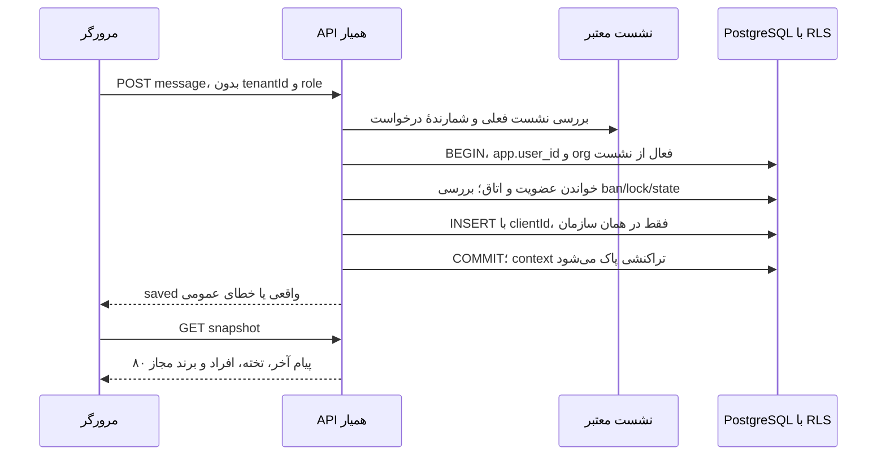

# راهنمای خواندن و توسعهٔ سورس همیار

این راهنما توضیح نسخهٔ جاری است. وضعیت قابلیت‌ها در [ROADMAP](ROADMAP.md) و روش اجرای مستقل در [SELF_HOSTING](SELF_HOSTING.md) است. منطق واقعی از دادهٔ نمونهٔ regression جداست؛ `/demo` و `/rooms/demo` روی production و Vercel پاسخ 404 می‌دهند.

## از کجا شروع کنم؟

| بخش                   | مسیر اصلی                                      | مسئولیت                                                        |
| --------------------- | ---------------------------------------------- | -------------------------------------------------------------- |
| قرارداد محصول         | `docs/PRODUCT.md`                              | مخاطب، نقش، محدوده و معیار آماده‌بودن                          |
| تصمیم‌های فنی         | `docs/adr/`                                    | دلیل انتخاب‌ها و تغییر تصمیم قبلی                              |
| ورودی و صفحه‌های حساب | `src/app/account/`                             | فرم‌های ورود، ثبت‌نام و مدیریت نشست                            |
| کارخانهٔ هویت         | `src/modules/identity/auth.ts`                 | hash رمز، نشست DB، محدودیت ایمیل و خروج                        |
| اتصال سرور            | `src/modules/identity/runtime.server.ts`       | pool محدود، فرستنده و بررسی نقش امن DB                         |
| سازمان‌ها             | `src/modules/tenancy/service.ts`               | سازمان فعال از نشست، عضویت تازه، نقش و دعوت ایمیلی             |
| اتاق‌ها               | `src/modules/rooms/repository.ts`              | ساخت/تخصیص اتاق، فهرست مجاز و projection نظارت                 |
| مجوز رسانه            | `src/modules/rooms/policy.ts`                  | توابع خالص join، مدیریت و منابع مجاز انتشار                    |
| همکاری کلاس           | `src/modules/classroom/service.ts`             | snapshot، چت، تخته، حضور، اجازه، اخراج و دعوت اتاق             |
| API کنترل             | `src/app/api/workspace/[...action]/route.ts`   | Origin، payload، rate limit، validation و dispatch             |
| صفحهٔ اتاق            | `src/app/rooms/[roomId]/page.tsx`              | نشست معتبر و snapshot اولیهٔ مجاز، بدون fallback نمونه         |
| رابط اتاق             | `src/components/classroom-panel.tsx`           | چرخهٔ دریافت snapshot، تب‌ها و اقدامات میزبان                  |
| تخته                  | `src/components/shared-board.tsx`              | قلم SVG، لمس، undo، پاک‌کردن و خروجی واقعی                     |
| صوت/تصویر             | `src/components/media-stage.tsx`               | SDK تنبل، دریافت واقعی، انتشار رضایتی، اشتراک صفحه و reconnect |
| امضای توکن            | `src/modules/media/issue-token.server.ts`      | کلید فقط روی سرور؛ توکن اتاق و نشست مشخص                       |
| دروازهٔ رسانه         | `scripts/media-gateway.mjs`                    | سرویس WS مستقل؛ کنترل اتصال تازه و لغو رسانهٔ برقرار           |
| سیاست دروازه          | `src/modules/media/gateway-policy.ts`          | تطبیق claim امضاشده با نقش/مجوز جاری DB                        |
| برند مجموعه           | `src/modules/organization-settings/service.ts` | نام، رنگ preset و پیام خوشامد معتبر                            |
| تیکت                  | `src/modules/support/service.ts`               | تیکت خصوصی عضو، پاسخ مدیر و بستن درخواست                       |
| دو محیط               | `src/modules/operations/deployment-mode.ts`    | allowlist سرویس‌های قابل استفاده در حالت داخلی                 |
| نصب مستقل             | `Dockerfile`, `infra/self-host/`               | وب، schema، PostgreSQL، SFU و gateway با کلیدهای جدا           |
| بستهٔ آفلاین          | `scripts/export-offline-release.mjs`           | آرشیو imageهای ازپیش‌ساخته، سورس commit و checksum             |

## مسیر کامل یک درخواست



کلاینت هرگز نقش یا سازمان معتبر را تعیین نمی‌کند. شناسهٔ route به‌تنهایی مجوز نیست. `inOrganization` نشست و membership را تازه بررسی می‌کند؛ `SET LOCAL` از باقی‌ماندن context در pool جلوگیری می‌کند. نقش `hamyar_app` مالک جدول و دارای bypass نیست؛ ۱۳ جدول سازمانی FORCE RLS دارند. نقش migration به برنامهٔ وب داده نمی‌شود. audit از app قابل UPDATE/DELETE نیست.

## قرارداد چت و تخته

چت پس از پاسخ موفق ذخیره‌شده محسوب می‌شود. ارسال مجدد همان متن ناموفق clientId قبلی را دارد؛ unique constraint جلوی پیام تکراری را می‌گیرد. متن HTML تفسیر نمی‌شود. حذف میزبان tombstone می‌سازد؛ snapshot متن مخفی‌شده را برنمی‌گرداند.

خط تخته حداکثر ۱۲۰ نقطه با مختصات محدود دارد؛ رنگ تنها سه preset و ضخامت ۲/۴/۸ است. author از نشست اضافه می‌شود. حرکت قلم draft را در DOM تغییر می‌دهد و در هر frame React را render نمی‌کند. خط پس از رهاکردن قلم ذخیره می‌شود. appendهای متفاوت همدیگر را حذف نمی‌کنند؛ clear و undo به revision مورد انتظار نیاز دارند. سقف فعلی ۲۰۰ خط است؛ ابتدا خروجی SVG بگیرید و سپس تخته را پاک کنید. نسخهٔ فعلی صفحه‌بندی/متن/فایل/CRDT زنده ندارد.

snapshot هر ۸ ثانیه بررسی می‌شود؛ برای محتوای بدون تغییر ETag خصوصی و پاسخ ۳۰۴ از انتقال دوبارهٔ کل تخته جلوگیری می‌کند. نشست و مجوز حتی پیش از پاسخ ۳۰۴ دوباره بررسی می‌شوند. بررسی در tab پنهان مکث می‌کند؛ بنابراین مشاهدهٔ پیام/خط نفر دیگر آنی نیست. حضور هر ۲۴ ثانیه تازه و پس از ۴۵ ثانیه غیرفعال محسوب می‌شود. این «حضور وب» است، نه شاهد دریافت رسانه یا گزارش حضور و غیاب قطعی.

## لینک دعوت اتاق با دعوت ایمیلی چه فرقی دارد؟

دعوت ایمیلی مجموعه به مالکیت ایمیل تأییدشده وابسته است. دعوت اتاق یک لینک محرمانهٔ قابل اشتراک است؛ هر فرد واردشده به حساب که آن را داشته باشد می‌تواند در محدودهٔ همان اتاق attendee شود. فرم اتاق پیش‌فرض ۲۴ ساعت و حداکثر ۳۰ پذیرش تازه می‌سازد؛ سرور بازهٔ ۱ تا ۷۲ ساعت و سقف ۱ تا ۲۰۰ را اعتبارسنجی می‌کند. token فقط یک بار برای سازنده نمایش داده می‌شود و در DB hash دارد. fragment URL به سرور در query/referrer فرستاده نمی‌شود. تکرار ورود همان عضو دوباره سهمیه مصرف نمی‌کند. لغو لینک دسترسی افرادی را که قبلاً پذیرفته شده‌اند حذف نمی‌کند؛ برای آن‌ها ban یا تعلیق لازم است.

## رسانه چگونه کار می‌کند؟

۱. کاربر «اتصال به صوت و تصویر» را می‌زند؛ درخواست `join-media` وضعیت جاری را می‌خواند.
۲. Next توکن بدون roomAdmin/data با identity سازمان:user و room سازمان:room می‌دهد. sessionId امضاشده است؛ نام نمایشی از حساب است.
۳. مرورگر از gateway به signaling خصوصی SFU می‌رسد؛ ویدئو/صوت با WebRTC مستقیم از SFU/TURN عبور می‌کنند.
۴. gateway JWT و Origin و نشست DB، نقش، ban، state و مجوزهای زمان‌دار را کنترل می‌کند؛ هر پنج ثانیه بررسی تکرار می‌شود.
۵. لغو مجوز publisher اتصال را می‌بندد و حذف در SFU درخواست می‌شود. دریافت اجازهٔ جدید نیاز به قطع/اتصال تازه دارد؛ دستگاه فرد خودکار روشن نمی‌شود.
۶. SDK adaptiveStream/dynacast/simulcast دارد؛ در قطع کوتاه reconnect می‌کند. قطع نهایی ورود مجدد با توکن و مجوز تازه می‌خواهد.

کلید خصوصی به مرورگر نمی‌رود. `LIVEKIT_URL` آدرس gateway عمومی است؛ `LIVEKIT_INTERNAL_URL` فقط مقصد خصوصی کنترل است. انتشار پورت خام 7880 ممنوع است؛ gateway نباید فقط یک proxy اختیاری باشد. دروازه را به‌عنوان Function ورسل اجرا نکنید. متغیر `HAMYAR_MEDIA_GATEWAY=enabled` یعنی اپراتور این مسیر را برقرار کرده؛ صرف تنظیم آن سلامت شبکه را ثابت نمی‌کند.

در `MediaStage` لغو/خروج generation را تغییر می‌دهد؛ نتیجهٔ دیرهنگام اتصال دور انداخته و trackها متوقف می‌شوند. جداشدن track remote فقط detach می‌کند، مالک دستگاه کاربر دیگری نیست. اجازهٔ پخش صدای مرورگر ممکن است کلیک جدا بخواهد. اشتراک صفحه تابع پشتیبانی مرورگر و انتخاب صریح کاربر است؛ روی همهٔ موبایل‌ها تضمین نمی‌شود.

## دو نسخه چگونه نگهداری می‌شوند؟

دو fork نداریم: یک image آزموده‌شده با دو پروفایل runtime. عادی می‌تواند از DB خارجی آزمایشی یا سرویس‌های خودمیزبان استفاده کند؛ domestic فقط میزبان‌های تأییدشدهٔ اپراتور را می‌پذیرد. تمام فونت و فایل‌های رابط محلی‌اند. adapter ایمیل SMTP به سرویس خودتان وصل می‌شود. در حالت بدون SMTP ثبت‌نام موقت بدون اثبات ایمیل ممکن است، اما بازیابی خاموش می‌ماند.

حالت داخلی دادهٔ Neon را جادویی روی VPS کپی نمی‌کند. image و source و backup و کلیدها و گواهی معتبر باید پیشاپیش منتقل و restore آزمایش شوند. registry، DNS خارجی یا پنل صدور گواهی در زمان قطع نباید پیش‌نیاز شروع باشند. مشخصات کامل در SELF_HOSTING است.

## تست و توسعه

```bash
npm ci
npm run check
npm run build
npm run build:gateway
# فقط روی DB مستقل با پسوند _test و نقش runtime غیرمالک:
npm run test:integration
npm run test:signup:e2e
npm run build:self-host
npm run test:standalone:e2e
```

unit tests سیاست/validation را می‌سنجند. integration دو سازمان، RLS و وضعیت‌های منفی را با PostgreSQL واقعی بررسی می‌کند. آزمون signup-e2e دو حساب بدون تأیید، دعوت اتاق، چت و تختهٔ ذخیره‌شده، برند و تیکت را با مرورگر واقعی اجرا می‌کند. `HAMYAR_TEST_MEDIA=1` تنها در محیط آزمون با SFU loopback و کلیدهای مصنوعی مستند در config، دریافت واقعی رسانه و رد reconnect کاربر banشده را هم فعال می‌کند. هیچ account fixture یا recording در production seed نمی‌شود. log/trace/screenshot و همهٔ envهای خصوصی خارج Git هستند.

## مرز آماده‌بودن

این سورس هنوز محصول کامل قابل فروش با SLA نیست: ضبط سروری و فایل خصوصی، مدل آموزشی ترم/درس/ثبت‌نام، ظرفیت و تعرفهٔ آزموده، backup/restore مقصد، امنیت مستقل، TURN روی ISPهای ایران و تمرین قطعی واقعی باز هستند. برای این بخش‌ها وضعیت موفق ساختگی نمایش ندهید؛ ROADMAP مرجع تحویل است.

## ورودی و بررسی دستگاه

`src/components/landing.tsx` و `src/app/landing.css` ورودی عمومی را با فونت محلی و CSS می‌سازند؛ حالت دمو همچنان فقط با flag توسعه فعال می‌شود. `/device-check` از `DeviceCheck` و `LocalCapture` استفاده می‌کند؛ هیچ SDK رسانه یا اتصال سرور برای تست دستگاه بارگذاری نمی‌شود. `device-preferences.tsx` در layout فقط شناسه‌های انتخاب‌شده را در حافظهٔ تب نگه می‌دارد. `MediaStage` آن‌ها را هنگام gesture روشن‌کردن دستگاه به SDK می‌دهد؛ مجوز و اتصال اتاق همان مسیر قبلی‌اند. `useAudioReaction` سطح صدا را مستقیم در متغیر CSS به‌روز می‌کند، بدون render در هر frame و بدون ذخیره/ارسال نمونه. برای بازگشت از تست به اتاق فقط UUID معتبر پذیرفته می‌شود؛ مقصد دلخواه/خارجی ساخته نمی‌شود.
