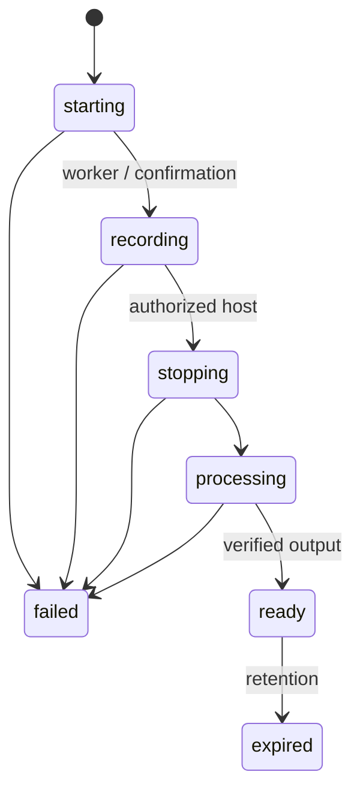

# ضبط توسط میزبان

ضبط واقعی در نسخهٔ پایه اجرا نشده است. هدف معماری، ضبط سمت سرور با LiveKit Egress است تا بستن لپ‌تاپ میزبان باعث ازبین‌رفتن فایل نشود. Egress در self-hosting سرویس مستقل و نیازمند ظرفیت CPU و storage است.

## جریان اجرایی

1. کاربر معتبر درخواست شروع می‌دهد؛ server سازمان، جلسهٔ باز، نقش، حالت حریم خصوصی، quota و idempotency key را بررسی می‌کند.
2. رکورد `starting` و audit در transaction ساخته و job در صف قرار می‌گیرد. unique constraint اجازهٔ دو ضبط فعال برای یک session نمی‌دهد.
3. worker از API پشتیبانی‌شدهٔ SDK نصب‌شده برای room composite استفاده می‌کند. URL template فقط از allowlist خودمان، خروجی فقط private bucket.
4. پس از موفقیت API و تأیید event، وضعیت `recording` به همه اعلام و نشانگر دائمی نمایش داده می‌شود. زمان شروع از server است.
5. میزبان مجاز توقف می‌دهد؛ worker توقف را idempotent انجام می‌دهد؛ وضعیت `stopping` سپس `processing`.
6. webhook امضاشدهٔ Egress خروجی را تأیید می‌کند؛ duplicate/out-of-order event نباید وضعیت نهایی را عقب ببرد. موفقیت فایل با size و metadata بررسی و `ready` می‌شود؛ خطا `failed`.
7. دسترسی به بازپخش هر بار tenant/ACL را بررسی و URL کوتاه‌عمر می‌دهد. job نگهداری فایل و metadata لازم را طبق retention حذف می‌کند.

## محتوای ضبط

MP4 کلاس با صدا، دوربین مدرس، اشتراک صفحه و layout مشخص. تختهٔ مشترک خودکار یک track ویدیویی نیست؛ باید در template ضبط render شود یا event log تخته با زمان server کنار media ذخیره و در بازپخش ترکیب شود. پیام خصوصی وارد composite نمی‌شود. یک PoC برای تخته، فونت فارسی و RTL template قبل از وعدهٔ ضبط کامل لازم است.

## خطاها و ظرفیت

worker restart باید egressId موجود را reconcile کند؛ start دوبارهٔ کورکورانه ممنوع. timeout، quota پر، bucket قطع، پایان اتاق در starting، حذف میزبان و قطع connection باید تست شوند. heartbeat و reconciliation job برای recordingهای stuck؛ سقف همزمانی جدا از تعداد اتاق‌های زنده. اعلان «ضبط در حال انجام است» فقط پس از تأیید واقعی.

در SDK نصب‌شده 2.19.1، متد `EgressClient.startEgress` وجود دارد و مبنای worker آینده است؛ مستندات جدید LiveKit آن را جایگزین برخی APIهای قبلی معرفی می‌کنند. وجود این متد در typeهای نصب‌شده بررسی شد؛ اجرای واقعی نیازمند PoC با Egress و storage است.
